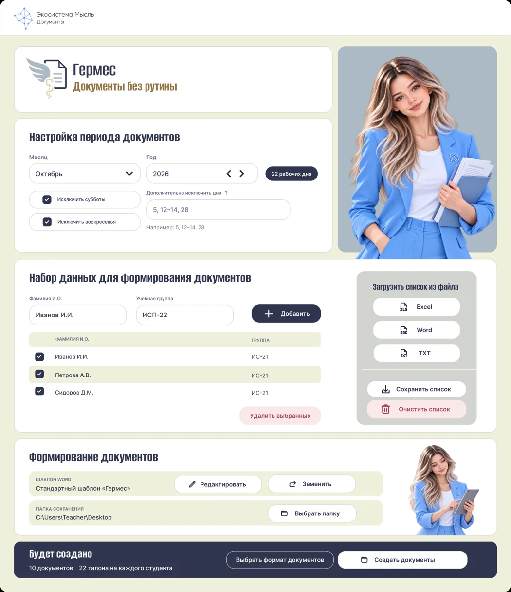

# Гермес

### Документы без рутины

**Настольное приложение экосистемы «Мысль» для автоматического формирования документов по шаблону Word.**

**Windows** · **DOCX и PDF** · **Локальная работа**

[**Загрузить**](https://github.com/Denizer1846/Hermes/releases) · [Руководство](docs/USER_GUIDE.md) · [Установка](docs/INSTALL.md) · [Условия использования](docs/RIGHTS.md)

---

> **Публичный установщик будет доступен в разделе [Releases](https://github.com/Denizer1846/Hermes/releases) после публикации первого выпуска.** Исходный код приложения не распространяется.

## Интерфейс

Иллюстрация утверждённого дизайна. Некоторые элементы могут отличаться в установленной версии.

## Возможности

| | |
| --- | --- |
| **Настройка периода** | Месяц и год, исключение суббот, воскресений, отдельных дат и диапазонов |
| **Списки студентов** | Добавление, редактирование и импорт из Excel, Word, TXT и текстовых PDF |
| **Шаблон Word** | Использование стандартного или собственного DOCX-шаблона |
| **Формирование документов** | Отдельный документ DOCX или PDF для каждого студента |
| **Удобное хранение** | Отдельная папка с месяцем и годом в выбранном каталоге |
| **Конфиденциальность** | Локальная подготовка документов без обязательной регистрации |

> Для экспорта PDF нужен установленный Microsoft Word или LibreOffice. Для импорта сканированных PDF без текстового слоя необходимо предварительное распознавание текста.

## Начало работы

1. Скачайте официальную сборку в [Releases](https://github.com/Denizer1846/Hermes/releases).
2. Запустите установщик Windows и откройте «Гермес».
3. Выберите период и добавьте студентов вручную либо импортируйте список.
4. Укажите шаблон Word, папку сохранения и формат DOCX или PDF.
5. Нажмите «Создать документы» и откройте папку с результатами.

Подробности: [руководство пользователя](docs/USER_GUIDE.md), [инструкция по установке](docs/INSTALL.md), [ответы на вопросы](docs/FAQ.md).

## Экосистема «Мысль»

«Гермес» создан для сокращения повседневной работы с однотипными образовательными документами.

**Автор и правообладатель: Denizer1846.** История изменений — в [CHANGELOG.md](CHANGELOG.md).

## Права на программу

© 2026 Denizer1846. Все права защищены. Этот репозиторий предназначен для пользовательской документации и официальных выпусков; это **не репозиторий с открытым исходным кодом**. Изменение, переупаковка и распространение производных версий без разрешения правообладателя не допускаются. Полные условия регулируются авторской лицензией; краткое разъяснение — в [docs/RIGHTS.md](docs/RIGHTS.md).

---

<strong>Экосистема «Мысль» · Гермес · Документы без рутины</strong>

